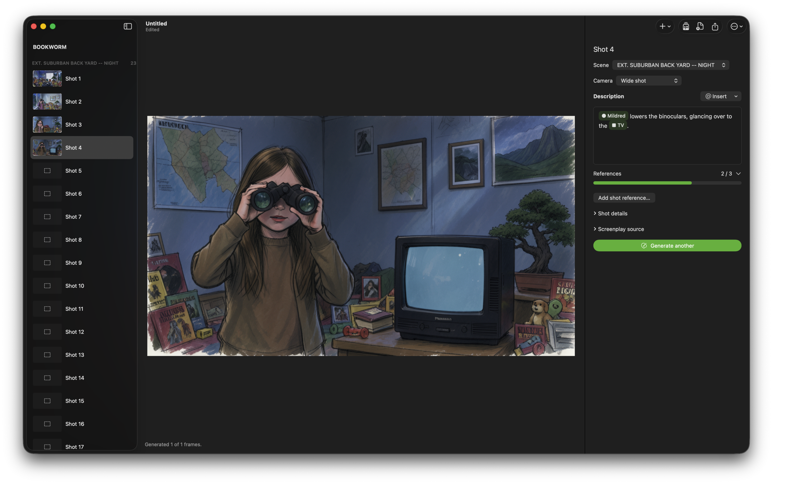

# SceneSketch

SceneSketch is a native Mac app for turning stories and screenplays into illustrated storyboards.  It generates sketch frames on your Mac, keeps reusable characters, locations, and props in each story, and exports boards for printing or production planning.

Story content and reference images stay local.  After the initial model download, drawing, prompt cleanup, image descriptions, and screenplay import work offline.  No subscription or API key is required to use the app.

[Download SceneSketch](https://github.com/adachis/SceneSketch/releases/latest)



## Requirements

- Apple Silicon Mac running macOS 15 or later.
- 16 GB or more unified memory is the target configuration.  Test renders peaked around 7.6 GB on an M5 Max; validation on a 16 GB Mac is still pending.
- Approximately 12.4 GB for the initial model download, plus the app and your story files.

## Getting started

Download the release archive, extract it, move the signed SceneSketch app to Applications, and open it.  First launch offers one download for all local features.  The trained sketch adapter is included with the app.

Downloads can pause and resume.  Completed files are checked against pinned SHA-256 hashes.  Settings provides model downloads, verification, storage selection, language, prompt cleanup, and export defaults.  Existing model files from earlier Storyboard versions are reused.

Create a story or import a screenplay, organize its scenes and shots, then generate frames.  Each `.sketchboard` file includes its story library, reference images, shot descriptions, generated images, and optional production metadata.  The file is portable and does not depend on the original reference-image paths.

## How it works

### Story Library

Keep descriptions and reference images for characters, locations, and props.  Insert an entry into a shot description as a pill.  Each pill stores a stable identifier, so renaming or editing the library entry updates future rendering prompts without rewriting every shot.

Adding reference images offers three choices when a description already exists: keep them as visual references, enhance the description, or propose a replacement.  Review generated descriptions before applying them.  Character image analysis focuses on stable physical appearance and excludes clothing and accessories.  Clothing can be entered manually or represented as a separate prop.

Each frame can use up to three reference images in total.  The reference meter shows the current selection.  The app chooses relevant images from the shot and linked library entries; you can override the selection.  Reference images are reduced for memory-efficient rendering, and character references use a face-focused crop when possible.

### Screenplay import

Import PDF, scanned PDF, Final Draft `.fdx`, Fountain, or UTF-8 text.  PDF text positions and on-device text recognition help recover scenes, action, and dialogue.  Character and prop matching patterns are prepared once per import; no embedding model is required.  Review and edit proposed scenes, shots, characters, locations, and props before importing.

Shot suggestions follow action paragraphs and need editorial judgment.  Props are proposed only when the screenplay describes their appearance.  Detection uses conservative English visual terms; add missed items manually.  Ambiguous object references remain plain text instead of being linked to the wrong prop.

### Local rendering

FLUX.2 Klein 4B runs in four-bit precision with the included storyboard-style LoRA.  The current configuration produces 1024 × 576 frames in four steps.  Text, vision, and image operations run serially to limit memory use.

Short prompt cleanup uses Qwen3 0.6B and rejects rewrites that discard the original content.  The shot action comes before supporting style and setting details in the rendering prompt.  Translation reuses the Qwen3 4B text encoder, and reference-image descriptions use Qwen3.5 2B.  Original descriptions remain unchanged in the story file.

Rendering prompts favor plain, unmarked surfaces.  An on-device text check may retry a frame once if it detects stray lettering, keeping the cleaner result.  Each completed version retains its image, seed, prompt, source description, and reference identifiers.  Open Render History to compare alternatives, select the active image for export, or restore an earlier shot description.  Generated images can still contain unwanted marks, duplicate subjects, or drift in appearance, so review them before use.

### Editing and recovery

Duplicate a shot to reuse its camera, description, references, and production notes as the starting point for a new image.  Approve completed shots and filter the board by missing images, unapproved shots, or approved shots.  Changing a shot’s visual inputs clears its approval.

Undo and Redo cover document edits, library changes, imports, and render selection.  SceneSketch also keeps a recent recovery snapshot and its previous valid version for up to 20 editing sessions.  Use File → Recover Storyboard to restore a snapshot; recovery can be undone.  Save important work normally with File → Save.

### Keyboard shortcuts

The Storyboard menu lists the main commands and their shortcuts.  Standard Mac shortcuts also work for New, Open, Save, Undo, Redo, and Settings.

| Action | Shortcut |
| --- | --- |
| Story Library | ⇧⌘L |
| Add shot / add scene | ⇧⌘N / ⌥⌘N |
| Duplicate shot | ⌘D |
| Previous / next shot | ⌘[ / ⌘] |
| Generate shot / scene | ⌘Return / ⇧⌘Return |
| Generate missing images in the scene | ⌥⌘Return |
| Stop after the current frame | ⌘. |
| Toggle approval | ⇧⌘A |
| Render history | ⇧⌘H |
| Import screenplay | ⇧⌘I |
| Export storyboard | ⇧⌘E |
| Production details | ⇧⌘P |
| Model setup | ⌥⌘M |
| Recover storyboard | ⌥⌘R |
| Delete selected shot | ⇧⌘Delete, then confirm |

### Exports

Export selected scenes as PDF, PNG images with JSON and CSV data, or a CSV shot list.  PDFs support Letter and A4, portrait and landscape, and 2, 3, 4, 6, 12, or 16 panels per page.  Choose whether to include descriptions, production details, and unrendered shots.  Long notes continue onto extra pages instead of being discarded.

The export sheet also offers independent Characters and Props options.  Enabled lists use the library pills in each shot description, preserve first-mention order, and show each entry once.  Plain-text mentions and location pills do not add characters or props.  These names appear under each PDF shot, including when descriptions are hidden, and as optional columns or fields in CSV and JSON exports.

Optional production fields include company, director, storyboard artist, revision, and date.  Shot fields include production number, lens, duration, camera movement, dialogue, and notes.  Paper size is chosen at export unless a preference is saved.

### Languages

The interface includes 119 languages and dialects.  Right-to-left layouts are supported.  Descriptions in other languages are translated locally for the image model; the original text remains in the document.  Translation quality varies, and not every language has received native-speaker review.  Some macOS menus follow a changed language after relaunching.

## Build from source

Use Xcode with Swift 6.3 and XcodeGen.

1. Place the trained adapter at `Resources/StoryboardStyle.safetensors`.  Large model weights and app archives are not stored in Git.  The adapter can be copied from an installed signed app:

   ```sh
   cp /Applications/SceneSketch.app/Contents/Resources/StoryboardStyle.safetensors Resources/
   ```

2. Build and package the app:

   ```sh
   ./build.sh
   ```

The output is `dist/SceneSketch.zip`.  Without a signing identity, this is an ad hoc development build.  Set `STORYBOARD_SIGN_IDENTITY` to a Developer ID identity for signing; notarization is a separate release step.  Model download revisions and dependency versions are pinned.  Internal Storyboard identifiers remain for compatibility with existing documents and preferences.

## Branches and releases

- `dev` is the default branch for ongoing work and regular commits.
- `main` contains released versions.  Promote a tested release from `dev` through a pull request after increasing the version and build in `project.yml`.
- Version tags use `vMAJOR.MINOR.PATCH` and point to the matching released commit on `main`.

Enable the local push guard after cloning:

```sh
git config core.hooksPath .githooks
```

The guard blocks direct updates to an existing remote `main` and rejects release tags that do not match a version on `main`.  The release-policy workflow checks release pull requests without building the app.  The public repository protects `main` with release pull requests and the Release policy check.  Keep the local guard enabled as well.  Compile, test, sign, and notarize release archives deliberately; routine development commits do not publish releases.

## Validation and release readiness

The project includes checks for document migration, library layout, references, screenplay parsing, props, downloads, and exports.  Validation runs on an M5 Max and includes document migration, recovery, download interruption, PDF layouts, and offline generation.  A physical 16 GB Mac and native-speaker review of every translation have not been tested.  Image generation can still miss staging details, especially with complex actions or strongly posed reference images.  Review frames before production use.

Model and dependency licenses are included in `Resources/ThirdPartyNotices.txt` and in the app bundle.

## References

- [FLUX.2 Klein 4B](https://huggingface.co/black-forest-labs/FLUX.2-klein-4B)
- [Qwen3](https://qwenlm.github.io/blog/qwen3/)
- [Qwen3.5 2B](https://huggingface.co/Qwen/Qwen3.5-2B)
- [Fountain syntax](https://fountain.io/syntax/)
